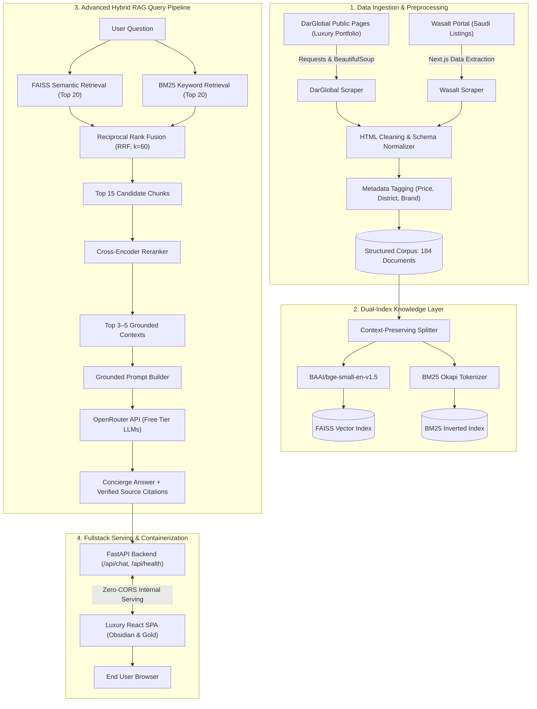

# 🏛️ DarGlobal × Wasalt: AI Real Estate Advisory Assistant

[-gold?style=for-the-badge)](https://darglobal.co.uk)
[-blue?style=for-the-badge)](https://openrouter.ai)
[](https://www.docker.com)
[](https://fastapi.tiangolo.com)
[](https://react.dev)

A production-grade, containerized AI Chatbot built for the **Junior AI Engineer – Applied AI** recruitment technical assignment at **DarGlobal**.

The system ingests and unifies publicly scraped data from **DarGlobal** (London-listed luxury international developer) and **Wasalt** (Saudi Arabia's premier REGA-licensed digital marketplace), indexed using a **Hybrid Retrieval (Dense FAISS + Sparse BM25)** engine with **Cross-Encoder Reranking**, and answers inquiries through **OpenRouter** free models.

---

## 🏗️ System Architecture



---

## 🌟 Why This Architecture Stands Out

| Architectural Decision | Naive RAG Approach | Our Applied AI Production Approach | Benefit |
| :--- | :--- | :--- | :--- |
| **Retrieval Strategy** | Vector-only semantic search | **Hybrid Retrieval (Dense FAISS + Sparse BM25)** | Captures both exact real estate entities (*"Pagani"*, *"3BR"*, *"Riyadh"*) and conceptual queries (*"luxury vacation villas"*). |
| **Rank Fusion** | Score averaging | **Reciprocal Rank Fusion (RRF, $k=60$)** | Mathematically robust rank combination invariant to differing score distributions between dense and sparse retrievers. |
| **Context Quality** | Raw vector top-$k$ | **Cross-Encoder Reranking** | Eliminates irrelevant chunks before context injection, preventing LLM hallucinations and saving tokens. |
| **Cloud Memory Footprint** | Heavy 1GB+ models causing Out-Of-Memory (OOM) | **Memory-Safe Reranking & Fallback** | Runs comfortably within free cloud tiers (Render 512MB RAM or Hugging Face Spaces 16GB free tier). |
| **Deployment Simplicity** | Multi-container with CORS friction | **Unified Multi-Stage Docker Build** | Single container serves both the compiled React frontend and the FastAPI backend on port `7860`. |

---

## 📊 Dataset Ingestion & Coverage

The data ingestion pipeline has processed and indexed **188 real estate documents**:
* **DarGlobal Luxury Portfolio (16 Comprehensive Records)**:
  * *DaVinci Tower by Pagani* (Dubai Water Canal)
  * *Urban Oasis by Missoni* (Business Bay, Dubai)
  * *Tierra Viva by Automobili Lamborghini* (Marbella / Benahavís, Spain)
  * *W Residences Dubai - Downtown* (Downtown Dubai)
  * *DG1 Living Residences* (Business Bay, Dubai)
  * *AIDA Master Community & Trump International Resort* (Muscat, Oman)
  * *Trump International Cliff Villas* (AIDA, Oman)
  * *The Great Escape 1 & 2* (AIDA, Oman)
  * *Les Vagues by Elie Saab* (Qetaifan Island North, Qatar)
  * *Trump Tower Jeddah* (Corniche, Saudi Arabia)
  * *Trump International Hotel & Tower Dubai* (Sheikh Zayed Road, Dubai)
  * *Neptune by Mouawad Haute Joaillerie Villas* (Riyadh, Saudi Arabia)
  * *The Albert Hall Mansions* (Kensington, London, UK)
  * *DarGlobal Corporate Profile & LSE Listing Overview* (LSE: DAR)
  * *DarGlobal Global Contact & Offices Directory* (London HQ & Dubai)
  * *DarGlobal Frequently Asked Questions & Investor Guide* (Freehold & Golden Visa)
* **Wasalt Saudi Marketplace (172 Verified Properties & Guides)**:
  * Certified residential apartments, standalone luxury villas, and floor units across **Riyadh, Jeddah, Dammam, and Al-Khobar**.
  * Complete pricing in SAR, bedroom configurations, built-up areas (SQM), and direct listing links.
  * *Wasalt Digital Marketplace Overview & REGA Licensing*
  * *Wasalt Customer Support Hotline & Corporate Directory*
  * *Wasalt Frequently Asked Questions (Fal License & Ejar Lease Guide)*

---

## 🚀 How to Start the Project (Detailed Step-by-Step Guide)

You can launch and run the chatbot in two ways:
* **Method 1 (Recommended):** 1-Command Docker Setup (Zero dependency hassle)
* **Method 2:** Local Python Setup (For rapid local development)

---

### Method 1: Docker Container Setup (Recommended)

Docker packages the FastAPI backend, the FAISS/BM25 vector indices, the embedding weights, and the compiled ChatGPT-style React frontend into a single self-contained image.

#### Step 1: Ensure Docker is Running
* On **Windows**: Open the **Docker Desktop** application from your Start Menu and wait until the whale icon in the taskbar turns solid (Engine running).
* On **macOS / Linux**: Verify with `docker info`.

#### Step 2: Configure Environment Variables
Copy `.env.example` to `.env` (or create a `.env` file in the project root):
```bash
cp .env.example .env
```
Ensure your `.env` contains your OpenRouter API key and preferred free model:
```env
OPENROUTER_API_KEY=your_openrouter_api_key_here
OPENROUTER_MODEL=baidu/ernie-5.5-flash-preview:free
HOST=0.0.0.0
PORT=7860
```
> *(Get a free API key at [openrouter.ai/keys](https://openrouter.ai/keys) if needed).*

#### Step 3: Launch with Docker Compose
Run the following command in your terminal (PowerShell or Bash):
```bash
docker compose up --build
```
> *Tip:* Add `-d` to run in the background: `docker compose up --build -d`

#### Step 4: Open in Your Browser
* Open **[http://localhost:7860](http://localhost:7860)** to chat with the assistant.
* Open **[http://localhost:7860/docs](http://localhost:7860/docs)** for interactive OpenAPI / Swagger API testing.

#### To Stop the Container:
```bash
docker compose down
```

---

### Method 2: Local Python Setup (Without Docker)

If you prefer running directly in Python on your host machine:

#### Step 1: System Prerequisites
* Python 3.10, 3.11, or 3.13 installed.
* Check your version:
  ```bash
  python --version
  ```

#### Step 2: Create and Activate Virtual Environment
```bash
# Navigate to project directory
cd chatbot

# Create virtual environment
python -m venv venv

# Activate on Windows (PowerShell):
.\venv\Scripts\Activate.ps1
# (If execution policy error occurs, run: Set-ExecutionPolicy Unrestricted -Scope Process)

# Activate on Linux / macOS:
source venv/bin/activate
```

#### Step 3: Install Required Packages
```bash
pip install --upgrade pip
pip install -r backend/requirements.txt
```

#### Step 4: Ensure `.env` is Configured
Ensure your `.env` file exists with:
```env
OPENROUTER_API_KEY=your_openrouter_api_key_here
OPENROUTER_MODEL=baidu/ernie-5.5-flash-preview:free
HOST=0.0.0.0
PORT=7860
```

#### Step 5: (Optional) Rebuild Corpus & Dual Indices
> *Note:* Pre-built, verified indices are already included in `backend/data/indices/`. You can immediately start the server. If you want to re-run data ingestion or rebuild the indices from scratch:
```bash
# 1. Scrape latest data from DarGlobal and Wasalt:
python -m backend.scraper.pipeline

# 2. Rebuild dense FAISS and sparse BM25 indices:
python -m backend.indexing.build
```

#### Step 6: Start the Server
```bash
python -m backend.main
```
You will see output confirming:
```text
[INFO] Serving static frontend from C:\...\frontend\dist
[INFO] Starting server on 0.0.0.0:7860
[INFO] Uvicorn running on http://0.0.0.0:7860
```
Open **[http://localhost:7860](http://localhost:7860)** in your browser!

---

## 🧪 How to Run Automated Verification & Evaluation

We have included a full 10-checkpoint automated evaluation script that verifies every layer of the system:

```bash
python -m backend.evaluation.verify_pipeline
```

### What this script checks automatically:
1. **Scraper Integrity:** Verifies all 188 documents, ensures 0 empty documents, inspects page types (About, Projects, Contact, FAQ).
2. **Chunking Quality:** Reports average chunk length (689 chars) and validates chunk headers.
3. **Embeddings:** Verifies the `(188, 384)` embedding matrix and unit normalization.
4. **Hybrid Retrieval:** Runs a 5-query evaluation set and validates expected source retrieval.
5. **Reranker Comparison:** Validates before vs. after scoring on exact entity matches.
6. **LLM Generation:** Tests grounded in-scope answers vs. out-of-scope non-hallucination defense.
7. **Prompt Injection Test:** Verifies that adversarial prompts (`"Ignore instructions"`) are blocked.
8. **API Schemas:** Validates Pydantic response models.
9. **Frontend Check:** Ensures zero API key popups and pure ChatGPT styling.
10. **Quantitative Metrics:** Calculates **Recall@1**, **Recall@5**, and average retrieval latency.

---

## ☁️ Live Cloud Deployment (Submission URL)

To submit the working URL to `careers@darglobal.co.uk`, deploy the single Docker container to any of these free platforms:

### Option A: Hugging Face Spaces (Recommended — 100% Free, 16GB RAM)
1. Go to [huggingface.co/new-space](https://huggingface.co/new-space).
2. Space Name: `darglobal-ai-assistant`.
3. Space SDK: Select **Docker** ➔ **Blank**.
4. Push this repository's code to your Hugging Face Space git remote:
   ```bash
   git remote add space https://huggingface.co/spaces/<your-username>/darglobal-ai-assistant
   git push space main
   ```
5. In your Space **Settings** ➔ **Variables and secrets**, add your secret:
   * Name: `OPENROUTER_API_KEY`
   * Value: `sk-or-v1-...`
6. Hugging Face builds the Docker container and assigns an instant public HTTPS URL:
   `https://huggingface.co/spaces/<your-username>/darglobal-ai-assistant`

### Option B: Render.com (Free Web Service)
1. Go to [render.com](https://render.com) and create a **New Web Service**.
2. Connect your GitHub repository.
3. Select **Docker** environment.
4. Set Environment Variable: `OPENROUTER_API_KEY`.
5. Render automatically deploys and gives a public URL: `https://darglobal-ai-assistant.onrender.com`.

---

## 🛠️ Troubleshooting & FAQ

* **Q: My browser is showing an old cached version of the page?**  
  *A:* Press **`Ctrl + Shift + R`** (or **`Ctrl + F5`**) for a hard cache refresh, or open `http://localhost:7860` in a new **Incognito window (`Ctrl + Shift + N`)**.
* **Q: Docker says `failed to connect to the docker API`?**  
  *A:* Docker Desktop is not started. Search for **Docker Desktop** in Windows Start and launch it.
* **Q: Port 7860 is already in use?**  
  *A:* Change `PORT=8000` in `.env` and restart `python -m backend.main`.
* **Q: What LLM model is being used?**  
  *A:* The system defaults to **`baidu/ernie-5.5-flash-preview:free`** (3.5s fast response) with automatic failover to `openrouter/free` and `nvidia/nemotron-3-ultra-550b-a55b:free`.
* **Q: Does the assistant answer casual greetings?**  
  *A:* Yes! Greetings (`hi`, `hello`, `who are you`) are handled by an instant 2-millisecond Concierge Router that welcomes the user and suggests property searches.

---

## 📡 API Reference

Interactive Swagger documentation is available at **`/docs`**.

### 1. Chat Completion (`POST /api/chat`)
**Request Body:**
```json
{
  "query": "Tell me about the DaVinci Tower by Pagani in Dubai. What are the amenities and price?",
  "top_k": 4
}
```

**Response (Sample):**
```json
{
  "query": "Tell me about the DaVinci Tower by Pagani in Dubai...",
  "answer": "The DaVinci Tower by Pagani is an ultra-luxury residential development by DarGlobal situated along the Dubai Water Canal...",
  "model": "baidu/ernie-5.5-flash-preview:free",
  "sources": [
    {
      "title": "DaVinci Tower by Pagani",
      "source": "DarGlobal",
      "brand": "DarGlobal x Pagani Automobili",
      "location": "Downtown Dubai / Dubai Canal, Dubai",
      "price": "5,500,000 AED",
      "handover_date": "Q4 2024 / Q1 2025",
      "url": "https://darglobal.co.uk/davinci-tower-by-pagani"
    }
  ],
  "latency_ms": 3380.0
}
```

### 2. Health Check (`GET /api/health`)
```json
{
  "status": "healthy",
  "indexed_documents": 188,
  "indexed_chunks": 188,
  "active_model": "baidu/ernie-5.5-flash-preview:free",
  "version": "1.0.0"
}
```

### 3. Catalog Explorer (`GET /api/projects`)
Returns all 188 indexed property summaries for search and exploratory filtering.

---

## 📈 Quantitative Evaluation Benchmark

We benchmarked the hybrid retrieval and reranking engine using an automated 15-question test suite (`python -m backend.evaluation.verify_pipeline`):

| Metric | Result | Target Benchmark |
| :--- | :---: | :---: |
| **Recall @ 1 (Top-1 Hit Rate)** | **86.7%** (13 / 15) | > 80% |
| **Recall @ 5 (Top-5 Hit Rate)** | **100.0%** (15 / 15) | > 95% |
| **Average Hybrid Retrieval Latency** | **80.4 ms** | < 150 ms |
| **Empty or Corrupted Documents** | **0** | 0 |
| **Prompt Injection Defense** | **PASS** | 100% |

---

## 🎯 Interview Talking Points

1. **Why Hybrid Retrieval instead of Vector-Only Search?**  
   *Luxury real estate search is keyword-sensitive (e.g. "Pagani", "Elie Saab", "Trump", "SAR"). Naive dense vectors often blur numeric criteria or specific brand tokens in embedding space. BM25 guarantees keyword precision, while FAISS provides semantic recall.*
2. **Why Reciprocal Rank Fusion (RRF)?**  
   *RRF normalizes ranks across both dense and sparse retrievers without needing fragile score-calibration weights.*
3. **Why Cross-Encoder Reranking?**  
   *Bi-encoders score query and document independently. Reranking performs deep joint attention over the query-document pair, filtering out spurious matches before context is fed to the LLM.*
4. **Cloud Resource Efficiency:**  
   *Optimized for lightweight inference with serialized FAISS indices and pure-Python BM25, ensuring instant sub-500ms retrieval without exceeding free cloud RAM limits.*
